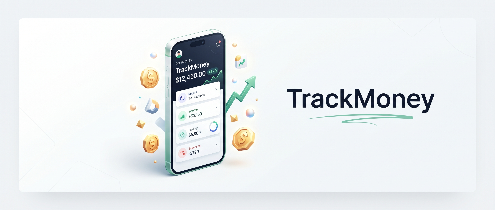
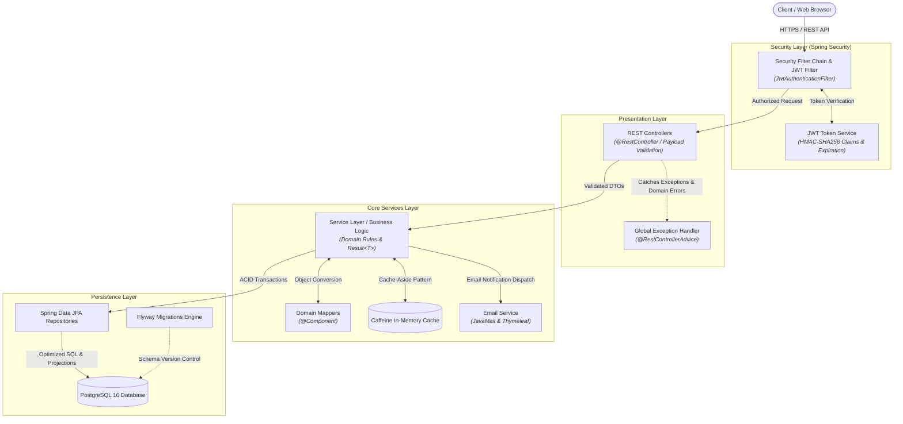

# <p align="center">TrackMoney API</p>

<p align="center">
  <em>A robust, secure, and modern RESTful API for smart personal finance management, expense tracking, category budgets, and real-time dashboard analytics.</em>
</p>

<p align="center">
  <!-- Badges: customize according to your project (shields.io) -->
  <a href="https://github.com/felipemelozx/Trackmoney/stargazers"></a>
  <a href="https://github.com/felipemelozx/Trackmoney/network/members"></a>
  <a href="https://github.com/felipemelozx/Trackmoney/issues"></a>
  <a href="https://github.com/felipemelozx/Trackmoney/blob/main/LICENSE"></a>
  <a href="https://github.com/felipemelozx/Trackmoney/actions"></a>
  <a href="https://sonarcloud.io/project/overview?id=felipemelozx_TrackMoney"></a>
</p>

<p align="center">
  <!-- Quick navigation links / Demo -->
  <a href="#-about">About</a> •
  <a href="#-features">Features</a> •
  <a href="#-tech-stack">Tech Stack</a> •
  <a href="#-architecture">Architecture</a> •
  <a href="#-getting-started">Getting Started</a> •
  <a href="https://trackmoney.felipemelozx.com" target="_blank">Live Demo 🚀</a>
</p>

---

<!-- Project Banner or Demonstration Screenshot -->
<p align="center">
  
</p>

---

## 📑 Table of Contents

1. [About](#-about)
2. [Features](#-features)
3. [Tech Stack](#-tech-stack)
4. [Architecture](#-architecture)
5. [Project Structure](#-project-structure)
6. [Getting Started](#-getting-started)
   - [Prerequisites](#prerequisites)
   - [Installation](#installation)
   - [Running](#running)
   - [Tests](#tests)
7. [Configuration & Environment Variables](#-configuration--environment-variables)
8. [Security](#-security)
9. [How to Contribute](#-how-to-contribute)
10. [What's Next (Roadmap)](#-whats-next-roadmap)
11. [License](#-license)
12. [Acknowledgements](#-acknowledgements)
13. [Author & Contact](#-author--contact)

---

## 💡 About

> [!NOTE]  
> The **TrackMoney API** is the core processing engine engineered to empower individuals to take complete control of their financial life through clean automation, strict security, and real-time insights.

The **TrackMoney API** was built to solve the fragmentation, manual overhead, and lack of visibility that people face when trying to organize their personal finances. Built with **Java 17** and **Spring Boot 3.4.5**, the application follows Clean Architecture principles, stateless dual-token (JWT) security, in-memory caching, and relational persistence backed by strict ACID transaction guarantees.

### 🎯 Key Objectives
- **Financial Efficiency**: Automate account balance reconciliation, category budget tracking, and monthly metric aggregations—eliminating manual spreadsheets.
- **Fast User Experience**: Deliver consolidated real-time dashboard data with sub-50ms response times via intelligent in-memory caching and optimized database queries.
- **Scalability & Reliability**: Modular layered architecture, strongly typed domain validations, and enterprise-grade security with dual-token authorization and RBAC.

### 🌐 Live Environments
- **Web Application (Demo)**: [https://trackmoney.felipemelozx.com](https://trackmoney.felipemelozx.com)
- **Production REST API**: [https://trackmoney.shardweb.app/api/v1](https://trackmoney.shardweb.app/api/v1)
- **Health Check Endpoint**: [https://trackmoney.shardweb.app/api/v1/actuator/health](https://trackmoney.shardweb.app/api/v1/actuator/health)
- **Swagger / OpenAPI (Local Dev)**: `http://localhost:8080/api/v1/swagger-ui/index.html`

---

## ✨ Features

- [x] 🔒 **Secure Dual-Token Authentication**: Email verification workflow with code dispatch, registration, login, and automatic token refresh via short-lived Access Tokens (15 min) and long-lived Refresh Tokens (7 days) signed with HMAC-SHA256.
- [x] 💸 **Full Transaction Management (CRUD)**: Income and expense entries with category tagging, pagination, date sorting, and instant balance reconciliation.
- [x] 📊 **Smart Category Budgets**: Monthly budget creation with percentage caps per category, real-time expenditure monitoring, and historical performance tracking.
- [x] 🎯 **Goal-Oriented Savings Pots**: Dedicated funds with target values, deposit and withdrawal capabilities, and visual progress tracking.
- [x] 🔁 **Recurring Bills & Subscriptions**: Scheduling and tracking for recurring expenses (weekly, monthly, yearly), categorizing items into upcoming, due, and paid.
- [x] 📈 **Analytics & Dashboard Metrics**: Monthly income vs. expense balance aggregates, proportional category breakdowns, and real-time financial health indicators.
- [x] ⚡ **High Performance & Caffeine Caching**: In-memory caching for read-heavy query endpoints with automatic cache invalidation triggered on mutation events.
- [x] 🧪 **Automated Quality & Testing**: Over 70% automated test coverage with JUnit 5, Mockito, and MockMvc, integrated with JaCoCo reports, Checkstyle style enforcement, and SonarCloud Quality Gate.

---

## 🛠️ Tech Stack

### Backend & Core
   

### Database & Storage
  

### Security, Validation & Utilities
 

### Build, Quality & Testing
     

### DevOps & Infrastructure
  

---

## 🏛️ Architecture

System architecture and interaction flow across layers:



- **Security Layer**: Stateless `OncePerRequestFilter` (`JwtAuthenticationFilter`), dual-token validation (HMAC-SHA256 via `JwtService`), and role-based access control (RBAC).
- **Presentation Layer (Controllers)**: Receives HTTP requests, validates incoming request payloads via Bean Validation (`@Valid`), documents contracts via OpenAPI/Swagger, and returns standardized `ApiResponse<T>` envelopes.
- **Service Layer (Business Logic)**: Encapsulates domain business rules, financial percentage constraints, transactional boundaries (`@Transactional`), and explicit error handling via the functional `Result<T>` pattern.
- **Mapping Layer**: Hand-written Spring `@Component` mappers performing clean, reflection-free object conversions between DTOs and persistent Entities without third-party annotation processor overhead.
- **Persistence Layer (Repositories & DB)**: Spring Data JPA interfaces executing optimized aggregate queries, pagination, and projections against PostgreSQL 16 with Flyway-managed schema migrations.
- **Infrastructure & Cross-Cutting**: Centralized exception handling via `@RestControllerAdvice` (`RestExceptionHandler`), in-memory caching with Caffeine, and asynchronous email dispatch with JavaMail and Thymeleaf.

---

## 📂 Project Structure

```bash
src/main/java/fun/trackmoney/
├── 📁 common/                        # Shared functional utilities and result types
│   └── 📁 result/                    # Functional Result<T>, ErrorCode, and HttpErrorMapper
├── 📁 config/                        # Global application and framework configurations
│   ├── 📁 exception/                 # Centralized exception handler (@RestControllerAdvice)
│   ├── 📁 startup/                   # Application startup integrity checks
│   ├── 📁 swagger/                   # OpenAPI / Swagger UI configuration
│   └── 📄 CorsConfig.java            # Cross-Origin Resource Sharing (CORS) setup
├── 📁 controller/                    # REST API Controllers (HTTP endpoints)
│   ├── 📄 AuthController.java        # Registration, login, and token refresh
│   ├── 📄 TransactionController.java # CRUD, pagination, and transaction filtering
│   ├── 📄 BudgetsController.java     # Budget limits and percentage tracking
│   ├── 📄 PotsController.java        # Savings goals, deposits, and withdrawals
│   ├── 📄 RecurringController.java   # Recurring subscriptions and bills
│   └── 📄 MetricsController.java     # Analytics and consolidated dashboard data
├── 📁 dto/                           # Data Transfer Objects organized by domain
├── 📁 entity/                        # JPA domain persistence entities
├── 📁 enums/                         # Domain enumerations (TransactionType, Frequency, etc.)
├── 📁 exception/                     # Domain-specific custom exceptions
├── 📁 infra/                         # Infrastructure implementations
│   ├── 📁 auth/                      # Security filters and authentication handlers
│   ├── 📁 cache/                     # Caffeine cache configuration and managers
│   ├── 📁 email/                     # Email dispatching via JavaMail and Thymeleaf
│   └── 📁 jwt/                       # JWT token generation, signing, and verification
├── 📁 mapper/                        # Hand-written DTO <-> Entity mappers (@Component)
├── 📁 repository/                    # Spring Data JPA repositories and query projections
├── 📁 service/                       # Business logic services and transactional orchestration
├── 📁 utils/                         # Validation helpers and response builders
└── 📄 TrackMoneyApplication.java     # Application entrypoint
```

---

## 🚀 Getting Started

Follow the steps below to run the project locally in your development environment.

### Prerequisites
- **Java JDK 17** or higher installed
- **Apache Maven 3.8+** (or use the included `./mvnw` wrapper)
- **Docker** & **Docker Compose**
- **Git**

### Installation

1. Clone the repository:
```bash
git clone https://github.com/felipemelozx/Trackmoney.git
cd Trackmoney
```

2. Configure environment variables:
```bash
cp .env.example .env
```

3. Spin up the PostgreSQL database container:
```bash
docker compose -f docker/docker-compose.yaml up -d
```

### Running

Start the application using the Maven wrapper:
```bash
./mvnw spring-boot:run -Dspring.profiles.active=dev
```

The API will be available at [http://localhost:8080/api/v1](http://localhost:8080/api/v1).

- **Interactive Documentation (Swagger UI)**: [http://localhost:8080/api/v1/swagger-ui/index.html](http://localhost:8080/api/v1/swagger-ui/index.html)
- **Application Health Check (Actuator)**: [http://localhost:8080/api/v1/actuator/health](http://localhost:8080/api/v1/actuator/health)

*(Optional: Run complete stack with production Docker Compose)*
```bash
docker compose -f docker/docker-compose.prod.yaml --env-file .env up -d --build
```

### Tests

Execute the automated test suite with the following commands:
```bash
# Run unit and integration tests
./mvnw test

# Run full verification suite (tests, JaCoCo coverage, Checkstyle audit)
./mvnw clean verify

# Run Checkstyle code style check independently
./mvnw checkstyle:check

# Run a specific test class
./mvnw test -Dtest="AccountServiceTest"
```

---

## ⚙️ Configuration & Environment Variables

The project requires the following environment variables configured in your `.env` file:

| Variable | Type | Required | Description | Example |
| :--- | :---: | :---: | :--- | :--- |
| `APP_PORT` | `number` | No | HTTP port exposed by the application | `8080` |
| `SERVER_CONTEXT_PATH` | `string` | No | Base context path for all REST endpoints | `/api/v1` |
| `SPRING_PROFILES_ACTIVE` | `string` | Yes | Active Spring profile (`dev` or `prod`) | `dev` |
| `POSTGRES_USER` | `string` | Yes | PostgreSQL database username | `trackmoney_user` |
| `POSTGRES_PASSWORD` | `string` | Yes | PostgreSQL database password | `your_secure_password` |
| `POSTGRES_DB` | `string` | Yes | PostgreSQL database name | `trackmoney_db` |
| `POSTGRES_PORT` | `number` | No | PostgreSQL database port | `5432` |
| `API_SECRET_KEY` | `string` | Yes | HMAC-SHA256 JWT secret key (at least 256 bits) | `openssl rand -base64 64` |
| `FRONT_URL` | `string` | Yes | Allowed frontend origin for CORS whitelist | `https://trackmoney.felipemelozx.com` |
| `SPRING_MAIL_HOST` | `string` | No | SMTP mail server host | `smtp.gmail.com` |
| `SPRING_MAIL_PORT` | `number` | No | SMTP mail server port | `587` |
| `SPRING_MAIL_USERNAME` | `string` | No | SMTP sender email account | `your-email@gmail.com` |
| `SPRING_MAIL_PASSWORD` | `string` | No | SMTP sender application password | `your-app-password` |

---

## 🛡️ Security

Security and financial data integrity are central to TrackMoney. Key implementations include:

- **Strong Cryptography & Password Hashing**: Passwords are encrypted using `BCrypt` with high salt work factors prior to database persistence.
- **Stateless Dual-Token Authentication**: Short-lived Access Tokens (15 min) and long-lived Refresh Tokens (7 days) signed via HMAC-SHA256.
- **Granular Role-Based Access Control (RBAC)**: Unconfirmed user accounts receive `USER_UNVERIFIED` (restricting access solely to code verification endpoints), elevating to `USER_ROLES` only after email confirmation.
- **Data Isolation & Tenant Security**: Every financial operation asserts that requested entities strictly belong to the authenticated user extracted from the JWT context.
- **SQL Injection Prevention**: Parameterized queries enforced via Spring Data JPA and Hibernate ORM.
- **Schema Validation**: Strict payload sanitization on every endpoint using Bean Validation (`@Valid`) with standardized error envelopes.
- **Configurable CORS Protection**: Explicitly whitelisted frontend origin access restricted by the `FRONT_URL` variable.

### Reporting Vulnerabilities
If you discover a security vulnerability in TrackMoney, please **DO NOT** open a public issue. Send an email directly to [felipemelozx@gmail.com](mailto:felipemelozx@gmail.com) or use GitHub's [Security Advisories](https://github.com/felipemelozx/Trackmoney/security/advisories) tab.

---

## 🤝 How to Contribute

Contributions are always welcome! To get started:

1. **Fork** the repository
2. **Create a Feature Branch**:
   ```bash
   git checkout -b feature/my-new-feature
   ```
3. **Commit your changes** following [Conventional Commits](https://www.conventionalcommits.org/):
   ```bash
   git commit -m "feat: add predictive budget forecasting"
   ```
4. **Push to your branch**:
   ```bash
   git push origin feature/my-new-feature
   ```
5. **Open a Pull Request** against the `develop` branch describing your changes and test results.

---

## 🗺️ What's Next (Roadmap)

Planned features and enhancements:

- [x] Stateless dual-token authentication (Access + Refresh JWT) with email verification.
- [x] Complete transaction management (CRUD) with pagination and category breakdown.
- [x] Monthly budget configuration with category spending percentage caps.
- [x] Savings pots for milestone goals with deposit and withdrawal capabilities.
- [x] Tracking and scheduling for recurring expenses and bills.
- [x] Real-time consolidated dashboard and monthly metric aggregations.
- [x] Automated CI/CD pipeline with GitHub Actions, SonarCloud, and VPS zero-downtime deployment.
- [ ] Export financial reports to PDF and CSV / Excel formats.
- [ ] Smart notifications via Web Push and Telegram / WhatsApp for upcoming bill due dates.
- [ ] AI-assisted predictive auto-categorization for financial transactions.

---

## 📄 License

This project is licensed under the **MIT License**. See the [LICENSE](LICENSE) file for more information.

```text
MIT License - Copyright (c) 2026 Felipe Melo
```

---

## 🙏 Acknowledgements

- [Spring Boot](https://spring.io/projects/spring-boot) - For the enterprise Java development framework.
- [SonarCloud](https://sonarcloud.io/) - For continuous code quality, coverage, and security analysis.
- [Shields.io](https://shields.io/) - For concise repository status badges.
- [Flyway](https://flywaydb.org/) - For reliable, version-controlled database schema migrations.
- To the open-source community for providing high-quality tools and libraries.

---

## 👤 Author & Contact

Developed with care by **Felipe Melo / @felipemelozx** 🚀

<p align="left">
  <a href="https://linkedin.com/in/felipemelozx" target="_blank">
    
  </a>
  <a href="https://github.com/felipemelozx" target="_blank">
    
  </a>
  <a href="https://felipemelozx.com" target="_blank">
    
  </a>
</p>
